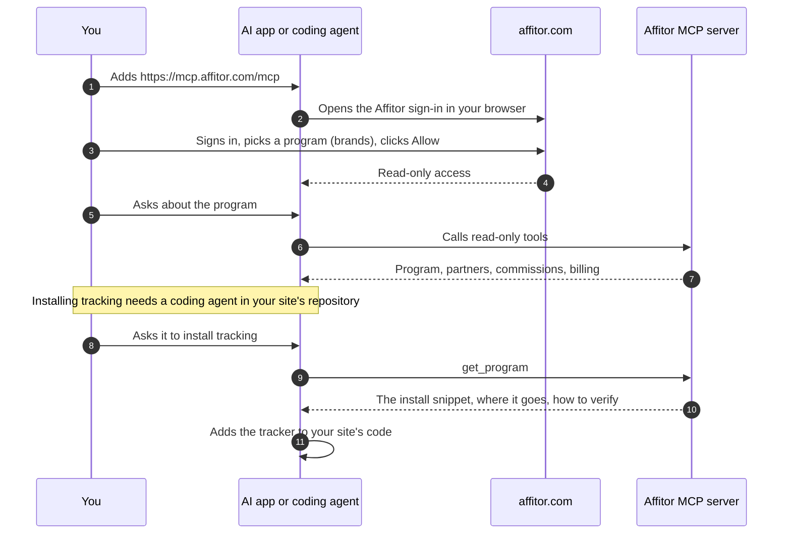

## What you need

<Checklist
  items={[
    { text: 'An Affitor program, or a partner account', href: '/docs/brand/quickstart/create-account' },
    { text: 'Claude, ChatGPT, Cursor, VS Code, Perplexity, Claude Code, Codex or another app that supports remote MCP servers', href: '/docs/api-reference/mcp#connect-your-ai-app' },
    { text: 'To install tracking: a coding agent open in your site\'s repository', href: '/docs/api-reference/mcp#example-prompts' },
  ]}
/>

The connection is read-only. Its only scope is `read`, and no tool writes, deletes or moves money: the app cannot approve an application, change a commission, create a link or send a payout. You sign in with your Affitor account, so no API key goes into the app, and the server refuses program API keys.

A brand connection covers one program and gets the 7 brand tools. A partner connection covers that partner's programs and gets the 5 partner tools. An app on a web address Affitor does not list is refused when it registers; apps on your own computer can connect.

## Steps

<UseCaseSteps
  items={[
    { title: 'Add the server', text: 'Paste `https://mcp.affitor.com/mcp` into your AI app\'s MCP or connector settings. In Claude Code, run `claude mcp add --transport http affitor https://mcp.affitor.com/mcp`, then run `/mcp`, pick affitor and sign in. In the dashboard, **Connect an AI tool** shows the server URL and the steps for Claude, Cursor, Claude Code and Codex.', href: '/docs/api-reference/mcp#connect-your-ai-app' },
    { title: 'Sign in and allow', text: 'Your browser opens affitor.com. Sign in, choose **As a brand** or **As a partner** if you are both, pick one **Program** as a brand, and click **Allow**. **Access** always says **Read-only**.', href: '/docs/api-reference/mcp#sign-in-and-allow-access' },
    { title: 'Ask about your program', text: 'Brand tools read the program, partners, applications, commissions and billing: `get_program`, `list_partners`, `get_partner`, `list_applications`, `list_commissions`, `get_commission_summary`, `get_billing`. Partner tools read your programs, links, earnings, commissions and payouts: `list_my_programs`, `list_my_links`, `get_my_earnings`, `list_my_commissions`, `list_my_payouts`.', href: '/docs/api-reference/mcp#tools' },
    { title: 'Install tracking with your coding agent', text: 'With a brand connection, ask the agent to call `get_program`, check that the program id is yours, and add the install snippet it returns: the tracker script tag or the npm package, where it goes and how to verify it. You deploy the change. Without MCP, the agent can follow the [agent skill](/docs/skill.md) with your program API key, or run `npx affitor onboard` with that key.', href: '/docs/api-reference/mcp#example-prompts' },
    { title: 'See or remove the connection', text: 'Brands: program menu › **Program settings**, then **Developers** › **AI agents** lists each connection with **Added** and **Last used**. Partners: **Integrations** in the account menu. **Remove** ends the connection at once: the app\'s next request gets `401`.', href: '/docs/api-reference/mcp#remove-access' },
  ]}
/>

  <a href="https://affitor.com/signup" className="aff-btn aff-btn-primary">Create free account</a>
  <a href="/docs/api-reference/mcp" className="aff-btn aff-btn-secondary">Read the MCP guide</a>

