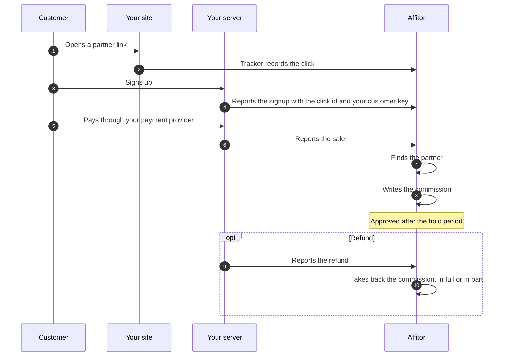

## What you need

<Checklist
  items={[
    { text: 'An Affitor program with its commission set', href: '/docs/brand/quickstart/setup-program' },
    { text: 'The Affitor tracker on your site', href: '/docs/brand/tracking/click-tracking' },
    { text: 'Your program API key, kept on your server', href: '/docs/brand/api-keys' },
    { text: 'Your own id for each customer, such as the user id', href: '/docs/brand/tracking/lead-tracking-signup' },
  ]}
/>

If you take payments with Stripe Checkout or Stripe subscriptions, [Sell on Stripe](/docs/use-cases/sell-on-stripe) needs no sale calls. With Stripe connected and your server reporting too, send each payment one way only: the same purchase sent both ways can count twice.

## Steps

<UseCaseSteps
  items={[
    { title: 'Add the tracker to your site', text: 'It records the click when a visitor arrives through a partner link, and keeps the click id in the `affitor_click_id` cookie on your domain.', href: '/docs/brand/tracking/click-tracking' },
    { title: 'Get your program API key', text: '**Program settings** › **Developers** › **API keys**, where an owner selects **Generate**. Keep the key on your server, never in the browser.', href: '/docs/brand/api-keys#where-to-find-it' },
    { title: 'Report the signup', text: 'When the customer signs up, your server sends `POST /api/v1/track/lead` with the `click_id` from the cookie and your `customer_key`. Affitor saves the key on the customer of that click.', href: '/docs/brand/tracking/lead-tracking-signup' },
    { title: 'Report each sale', text: 'After each payment, your server sends `POST /api/v1/track/sale` with the `customer_key` (or the `click_id`, for a buyer who never signed up), `amount_cents` and a unique `transaction_id`. A `transaction_id` sent again is answered `409` and not counted twice.', href: '/docs/api-reference/track-sale' },
    { title: 'Report refunds', text: 'When you refund a payment, send its `transaction_id` to `POST /api/v1/track/refund`, and Affitor reverses the commission. A partial refund reduces a commission already approved and cancels one still `pending` (in its hold period, not yet approved).', href: '/docs/api-reference/track-refund' },
    { title: 'Send a test sale', text: '**Program settings** › **Payments** › **Send a test sale** shows a call to run from your server. Put your own `transaction_id` in it, or leave it out: an id that was already used gets `409` and records nothing. With `"livemode": false` it records a test sale and no commission, and the **Server API** card reads **Received**.', href: '/docs/brand/tracking/testing-integration' },
  ]}
/>

  <a href="https://affitor.com/signup" className="aff-btn aff-btn-primary">Create free account</a>
  <a href="/docs/brand/tracking/quickstart-integration" className="aff-btn aff-btn-secondary">Read the integration guide</a>

