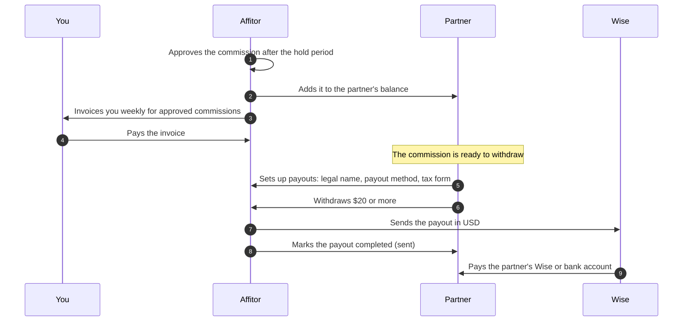

## What you need

<Checklist
  items={[
    { text: 'An Affitor program whose sales create commissions', href: '/docs/brand/quickstart/commission-approval-cash-flow' },
    { text: 'Your weekly Affitor invoice, paid', href: '/docs/brand/billing/overdue-policy' },
    { text: 'Partners who finished payout setup: legal name, a Wise or bank account, a tax form', href: '/docs/partners/payouts#1-get-ready-to-be-paid' },
  ]}
/>

You never send partner transfers, collect bank details or see tax forms. Each partner adds their own payout details, and Affitor pays every partner in USD through Wise: to a Wise account email, or to a bank account in the partner's legal name. PayPal is not a payout method.

Approval and payment are separate steps. An approved commission is added to the partner's balance at once, but it shows as **Awaiting brand payment** until you pay the invoice that covers it. Your weekly invoice covers the approved commissions plus the platform fee.

## Steps

<UseCaseSteps
  items={[
    { title: 'Approve commissions', text: "A new commission is **Pending** for the program's hold period, set under **Commission** in program settings. When the hold ends (later, if you extended it), Affitor approves it, unless you approved or rejected it first from **Commissions**. A test commission, a $0 commission on a payment after the commission term has ended, and one earned by someone on your own team (the brand owner or a workspace member) are not approved on their own.", href: '/docs/brand/quickstart/commission-approval-cash-flow#approval-and-hold-workflow' },
    { title: 'Pay your invoice', text: 'Affitor invoices you weekly for the approved commissions. When the invoice is paid, its commissions move to **Collected** and the partner can withdraw them.', href: '/docs/brand/billing/overdue-policy' },
    { title: 'The partner sets up payouts', text: "In **Your account** › **Payouts**, **Get ready to be paid** lists what is missing: a verified email, a **Legal name**, a payout method (a Wise account email, or a bank account in that legal name) and a tax form signed in the same name. The tax form is a W-8BEN or W-8BEN-E, valid for 3 calendar years, or a W-9, which counts once Affitor's accountant has received it.", href: '/docs/partners/payouts#1-get-ready-to-be-paid' },
    { title: 'The partner withdraws', text: 'On the **Payout** page, **Withdraw** turns on once $20 is ready to withdraw. The partner withdraws any amount from $20 up to what is ready, to one of their saved payout methods, and sees any processing fee before they confirm.', href: '/docs/partners/payouts#2-withdraw' },
    { title: 'Affitor sends the payout', text: "The Affitor team reviews the withdrawal, sends it through Wise and marks it sent. **Payout history** shows it as **Pending**, then **Processing**, then **Completed**. Wise converts the USD if the partner holds another currency, and the partner's bank or Wise decides how long the money takes to arrive.", href: '/docs/partners/payouts#3-when-you-get-paid' },
  ]}
/>

  <a href="https://affitor.com/signup" className="aff-btn aff-btn-primary">Create free account</a>
  <a href="/docs/brand/quickstart/payouts" className="aff-btn aff-btn-secondary">Read the payouts guide</a>

