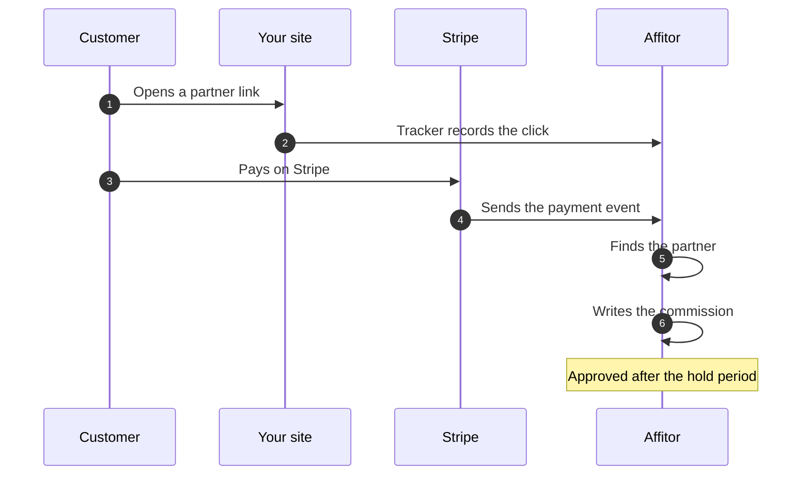

## What you need

<Checklist
  items={[
    { text: 'An Affitor program with its commission set', href: '/docs/brand/quickstart/setup-program' },
    { text: 'A Stripe account, activated and connected to the program', href: '/docs/brand/tracking/connect-stripe-account' },
    { text: 'The Affitor tracker on your site', href: '/docs/brand/tracking/click-tracking' },
    { text: 'Stripe Checkout, Payment Links, the Buy Button or the Pricing Table', href: '/docs/brand/tracking/payment-tracking-stripe' },
  ]}
/>

Stripe events credit Checkout purchases and subscription payments. A payment outside them, such as a PaymentIntent your server confirms, is not credited from Stripe: report it from your server ([Track Sale](/docs/api-reference/track-sale)).

## Steps

<UseCaseSteps
  items={[
    { title: 'Add the tracker to your site', text: 'It records the click when a visitor arrives through a partner link. Put it on the pages with your Stripe links and buttons too.', href: '/docs/brand/tracking/click-tracking' },
    { title: 'Connect Stripe', text: '**Program settings** › **Payments** › **Connect Stripe**, as the program owner.', href: '/docs/brand/tracking/connect-stripe-account#step-3-connect-it-to-your-program' },
    { title: 'Pass the click to checkout', text: 'On Payment Links, the Buy Button and the Pricing Table, the tracker on the page does it. Your own Checkout Session adds `affitor_click_id` to its metadata, and to `subscription_data.metadata` for a subscription.', href: '/docs/brand/tracking/payment-tracking-stripe' },
    { title: 'Make a test purchase', text: "Buy a one-time price through a partner link, in the connected account's test mode. **Commissions** lists it as **Test**.", href: '/docs/brand/tracking/connect-stripe-account#step-4-test-with-stripe-test-mode' },
  ]}
/>

  <a href="https://affitor.com/signup" className="aff-btn aff-btn-primary">Create free account</a>
  <a href="/docs/brand/tracking/payment-tracking-stripe" className="aff-btn aff-btn-secondary">Read the Stripe guide</a>

