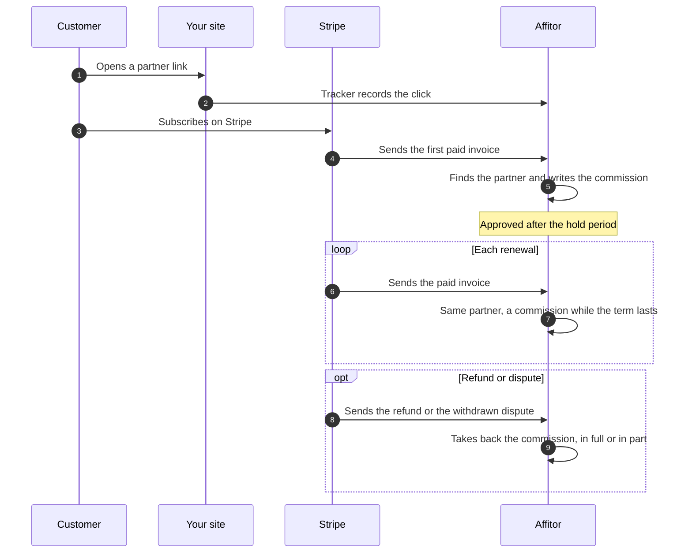

## What you need

<Checklist
  items={[
    { text: 'An Affitor program with its commission type set', href: '/docs/brand/quickstart/setup-program#step-2-set-your-commission' },
    { text: 'A Stripe account, activated and connected to the program', href: '/docs/brand/tracking/connect-stripe-account' },
    { text: 'The Affitor tracker on your site', href: '/docs/brand/tracking/click-tracking' },
    { text: 'Subscriptions billed by Stripe on that account', href: '/docs/brand/tracking/payment-tracking-stripe#subscription-example' },
  ]}
/>

Each paid invoice of the subscription is a sale: the first one, then every renewal. Renewals go to the partner of the first payment, through the click passed at checkout or the buyer's email or Stripe customer ID. The attribution window applies only to that first payment: once the customer has paid, renewals are credited however old the click is. The rate is the same for every plan, price and billing interval.

Canceling, pausing or changing the plan writes nothing in Affitor: a canceled subscription stops earning because it stops paying, and after a plan change each paid invoice earns at the same rate. A refund or dispute is matched to its invoice and reverses the commission; some older sales, such as one payment shared by several invoices, are held for manual reconciliation instead. A new invoice whose payment was already refunded, even in part, before Affitor processed it is not recorded as a sale. A new invoice paid by several charges, or by one payment that also paid other invoices, is not recorded automatically. If you bill subscriptions outside Stripe, your server reports each payment and each refund ([Any payment provider](/docs/use-cases/any-payment-provider)).

## Steps

<UseCaseSteps
  items={[
    { title: 'Connect Stripe', text: '**Program settings** › **Payments** › **Connect Stripe**, as the program owner. Your subscriptions must bill on the Stripe account you connect.', href: '/docs/brand/tracking/connect-stripe-account#step-3-connect-it-to-your-program' },
    { title: 'Pass the click to the subscription', text: 'On Payment Links, the Buy Button and the Pricing Table, the tracker on the page does it. Your own Checkout Session adds `affitor_click_id` to `subscription_data.metadata`: invoices carry the subscription\'s metadata, not the session\'s.', href: '/docs/brand/tracking/payment-tracking-stripe#subscription-example' },
    { title: 'Choose how long renewals earn', text: '**Program settings** › **Commission** › **Type**. **One-time** earns on the first payment for a product, not on its renewals. **Lifetime** earns on every paid invoice. **Recurring** earns until the months in **For** have passed since the customer\'s first click on the partner link, not since the first payment: with 12 months, a customer who clicked in January and subscribed in March earns the partner commissions until January of the next year.', href: '/docs/brand/quickstart/setup-program#step-2-set-your-commission' },
    { title: 'Refund in Stripe', text: 'Refund an invoice in Stripe, a renewal or the first one, and Affitor finds its commission: a full refund reverses it, a partial refund reduces a commission already approved and cancels one still `pending` (in its hold period, not yet approved). A dispute takes the commission back when Stripe withdraws the funds. If you win it, the commission stays reversed and you get a notification to review it.', href: '/docs/brand/quickstart/commission-approval-cash-flow#refund-handling' },
    { title: 'Make a test subscription', text: "In the connected account's test mode, subscribe through a partner link on your own Checkout Session, with the click in `subscription_data.metadata`. **Commissions** lists the first payment as **Test**. A test subscription from a Payment Link, the Buy Button or the Pricing Table can show no commission.", href: '/docs/brand/tracking/connect-stripe-account#step-4-test-with-stripe-test-mode' },
  ]}
/>

  <a href="https://affitor.com/signup" className="aff-btn aff-btn-primary">Create free account</a>
  <a href="/docs/brand/tracking/payment-tracking-stripe" className="aff-btn aff-btn-secondary">Read the Stripe guide</a>

